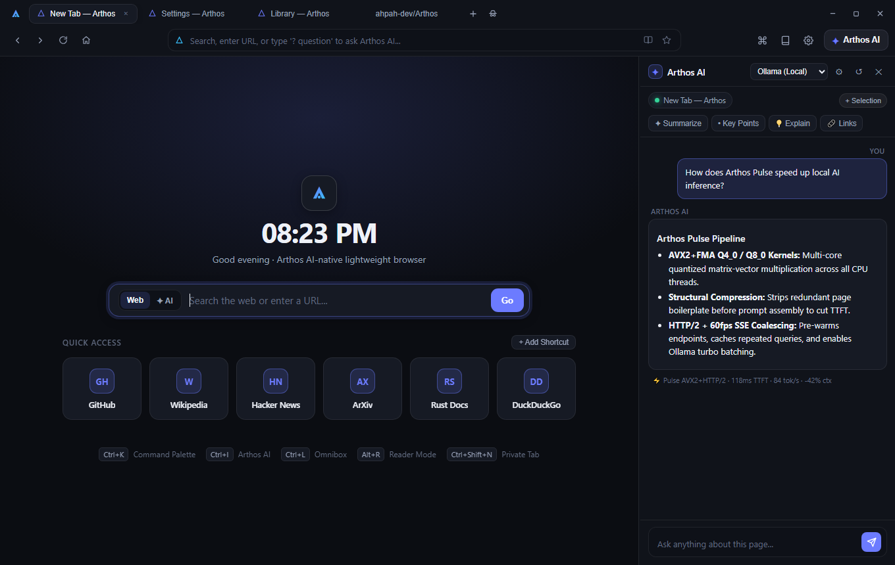
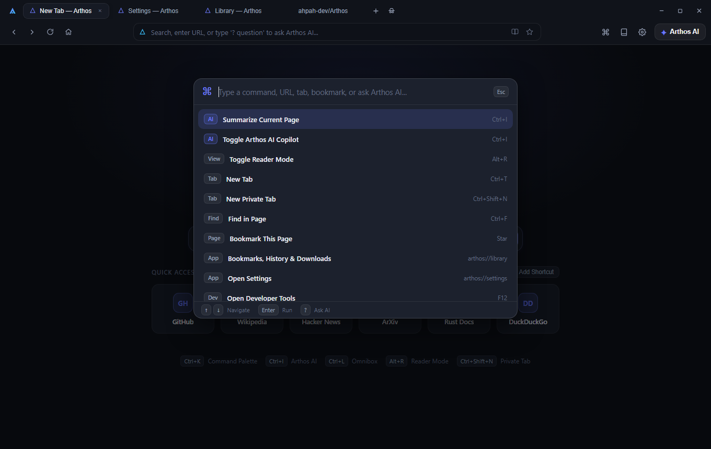
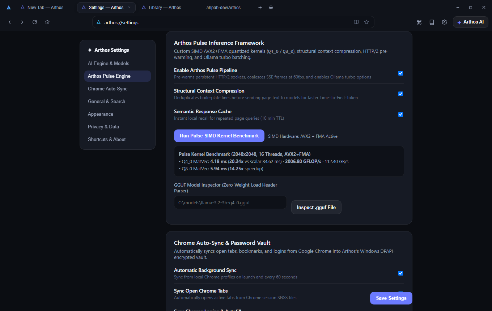
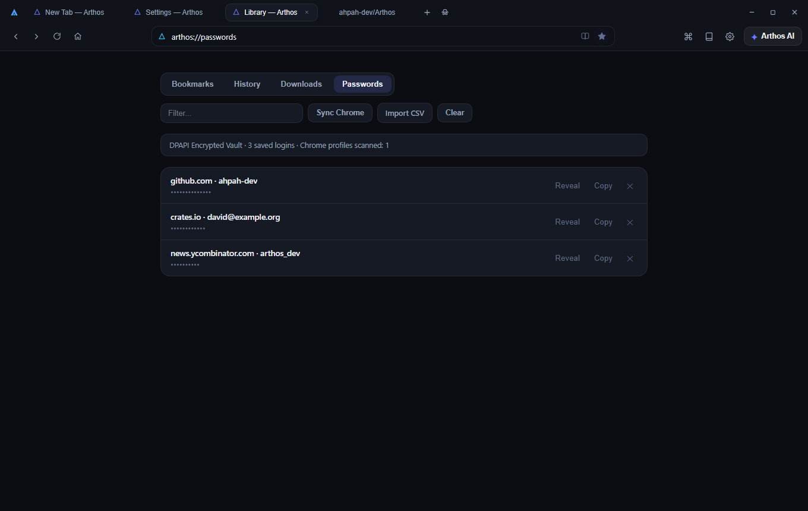

# Arthos

**An AI-native, super lightweight open-source web browser built in Rust.**

Arthos pairs a native OS web engine (WebView2 on Windows, WKWebView on macOS, WebKitGTK on Linux) with a fast, distraction-free interface and deeply integrated AI tools — delivering modern web compatibility at a fraction of the binary size and memory footprint of Chromium-bundled browsers.

Released into the public domain under the [Unlicense](UNLICENSE).

---

## Screenshots

| New Tab & AI Copilot Sidebar (`Ctrl+I`) | Command Palette (`Ctrl+K`) |
|---|---|
|  |  |

| Arthos Pulse Inference Engine & Chrome Auto-Sync | DPAPI Encrypted Password Vault (`arthos://passwords`) |
|---|---|
|  |  |

---

## Features

- **Super Lightweight Native Core**: Written in Rust using [`tao`](https://github.com/tauri-apps/tao) and [`wry`](https://github.com/tauri-apps/wry). No Electron, no bundled Node runtime, no 200 MB browser binary.
- **Multi-Tab Real Web Rendering**: Isolated WebView tabs with shared persistent profile cookies/sessions, private/incognito tabs (`Ctrl+Shift+N`), `target="_blank"` tab handling, zoom controls, downloads tracking, and DevTools (`F12`).
- **AI Copilot Sidebar (`Ctrl+I`)**:
  - **Page-Aware Context**: Optionally shares active page text, headings, links, and selected text with a toggleable privacy indicator.
  - **One-Click Actions**: Summarize, Key Points, Explain Simply, Extract Links, and Grab Selection.
  - **Floating Selection Pill**: Highlight text on any page to explain, summarize, or ask AI immediately.
  - **Real-Time Streaming Markdown**: Crisp headings, lists, links, and syntax-ready code blocks with one-click copy.
- **Multi-Provider AI Engine + Arthos Pulse (`arthos-pulse`)**:
  - **Arthos Pulse Inference Framework (`crates/arthos-pulse`)**: Custom Rust crate providing runtime-dispatched **AVX2+FMA SIMD quantized `Q4_0`/`Q8_0` MatVec** kernels, RMSNorm/SwiGLU/Softmax/Paged KV cache primitives, zero-weight-load **GGUF v2/v3 header inspector**, structural webpage context compression, LRU semantic cache, HTTP/2 pre-warming, 60fps SSE frame coalescing, and live TTFT / `tok/s` telemetry.
  - **Local Instant Mode**: Works out of the box with zero API keys (on-device page snapshot, reading time, outline, links, and excerpt analysis).
  - **Ollama (Local & Private)**: Auto-detects installed local models from `http://localhost:11434` with Pulse turbo parameters (`keep_alive`, `num_batch`, `num_ctx`, multi-core `num_thread`).
  - **OpenAI**, **Anthropic Claude**, **Google Gemini**, and **Custom OpenAI-Compatible Endpoints** (Groq, DeepSeek, OpenRouter, LM Studio, vLLM).
- **Automatic Chrome Sync & DPAPI Password Vault**:
  - Automatically syncs open Chrome tabs (SNSS parser), bookmarks, and saved logins from Google Chrome profiles on startup and every 60 seconds.
  - Stores synced credentials encrypted locally via Windows **DPAPI** (`CryptProtectData`), provides a Shadow-DOM autofill pill on login forms, a searchable `arthos://passwords` vault manager, and standard Chrome Passwords `.csv` import for Chrome v20 App-Bound Encryption logins.
- **AI Smart Omnibox (`Ctrl+L`)**: Navigate URLs, search via DuckDuckGo / Google / Brave / Kagi / Perplexity, or start any query with `? ` or `/ai ` to ask Arthos AI directly.
- **Command Palette (`Ctrl+K`)**: Fuzzy jump across tabs, bookmarks, history, browser commands, and AI actions.
- **Distraction-Free Reader Mode (`Alt+R`)**: Extracts clean article content with adjustable font size, Serif/Sans toggle, Default/Sepia/Paper themes, and one-click AI summarization.
- **Built-In `arthos://` Pages**:
  - `arthos://newtab` — Minimal start page with clock, dual Web/AI search bar, and customizable Speed Dial.
  - `arthos://settings` — AI providers, Arthos Pulse SIMD benchmark & GGUF inspector, Chrome auto-sync controls, themes, accent colors, and privacy controls.
  - `arthos://library` (`arthos://bookmarks`, `arthos://history`, `arthos://downloads`, `arthos://passwords`) — Unified searchable library & password vault.

---

## Keyboard Shortcuts

| Shortcut | Action |
|---|---|
| `Ctrl+T` | New Tab |
| `Ctrl+Shift+N` | New Private Tab |
| `Ctrl+W` | Close Active Tab |
| `Ctrl+Tab` / `Ctrl+Shift+Tab` | Next / Previous Tab |
| `Ctrl+L` / `Alt+D` | Focus AI Omnibox |
| `Ctrl+K` | Open Command Palette |
| `Ctrl+I` | Toggle AI Copilot Sidebar |
| `Ctrl+F` | Find in Page |
| `Alt+R` | Toggle Reader Mode |
| `Alt+Left` / `Alt+Right` | Back / Forward |
| `Ctrl+R` / `F5` | Reload Page |
| `Ctrl+=` / `Ctrl+-` / `Ctrl+0` | Zoom In / Out / Reset |
| `F12` | Open Developer Tools |

---

## Building from Source

### Prerequisites

- [Rust](https://rustup.rs/) (1.85+)
- **Windows**: WebView2 Runtime (pre-installed on Windows 10/11) and MSVC Build Tools
- **macOS**: Xcode Command Line Tools
- **Linux**: `libwebkit2gtk-4.1-dev`, `libgtk-3-dev`, `libayatana-appindicator3-dev`

### Run & Build

```bash
# Development run
cargo run

# Optimized lightweight release binary
cargo build --release
```

The release binary is output to `target/release/arthos` (or `target/release/arthos.exe` on Windows).

---

## Architecture

```text
Arthos/
├── crates/arthos-pulse/ # Custom SIMD AVX2+FMA Q4_0/Q8_0 inference kernels, GGUF parser & pipeline cache
├── src/
│   ├── main.rs        # Event loop, multi-webview orchestrator, IPC dispatcher & auto-sync timer
│   ├── browser.rs     # Tab state, IPC command schemas, chrome/internal sync payloads
│   ├── chrome_sync.rs # Chrome SNSS tabs, bookmarks, SQLite Login Data & DPAPI credential vault
│   ├── ai.rs          # Pulse-accelerated streaming clients (OpenAI, Anthropic, Gemini, Ollama, Local)
│   ├── config.rs      # Persistent JSON settings/bookmarks/history/speed-dial + omnibox resolver
│   ├── protocol.rs    # Custom `arthos://` protocol serving embedded UI assets
│   └── win32.rs       # Windows 11 DWM rounded corners & dark frame integration
└── ui/
    ├── theme.css      # Unified Obsidian Dark & Porcelain Light design tokens
    ├── chrome.*       # Tab strip, frameless window controls, AI omnibox, find bar
    ├── sidebar.*      # Resizable AI Copilot sidebar & streaming Markdown renderer
    ├── overlay.*      # Translucent Command Palette (Ctrl+K)
    ├── content_bridge.js # Lightweight page script (shortcuts, DOM/Reader extractor, selection pill)
    ├── newtab.html    # Start page (`arthos://newtab`)
    ├── settings.html  # Settings & AI provider configuration (`arthos://settings`)
    ├── library.html   # Bookmarks, history, downloads (`arthos://library`)
    └── reader.html    # Distraction-free Reader Mode (`arthos://reader`)
```

---

## License

This project is released into the public domain under **The Unlicense**. See [UNLICENSE](UNLICENSE) for details.
